I had a fantastic (and slightly stressful) birthday week this year. More importantly, unlike previous years, I wasn't feeling awful about myself. Instead, I felt this immense pride that I'd achieved ambitions that my teenage self had for herself. Over the birthday week, I got to spend quality time with myself and my close friends. I also put myself through two back-to-back events: a conference where I presented and a workshop I organised. Both were stressful (uncomfortable even), but happy that I'm persevering through to seek new experiences.

A brief rundown as usual.

## 2026-11-06 to 2026-11-08 (Friday to Sunday): Deepavali Celebrations
I had a rather decent Deepavali this year. With the festival coinciding with Guy Fawkes night here in the UK, I got to burst some fire crackers myself at the TG square on Friday. Holding the sparklers, being fascinated as ever by the jagged, electric shapes it made, felt so nostalgic!
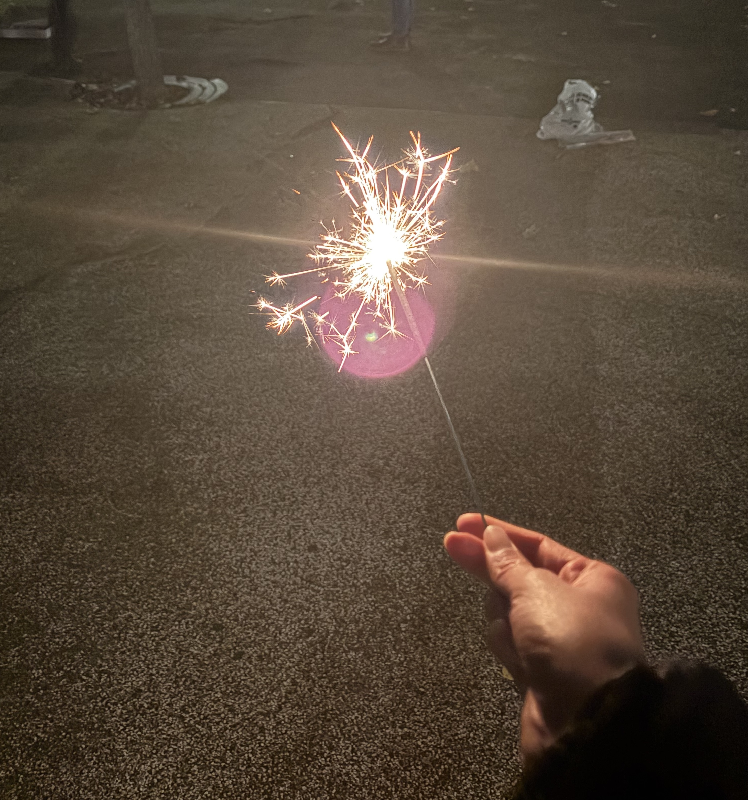

_Sparklers at Guy Fawkes_

A friend I made at the Indian students' protest invited me to her Diwali party on Saturday. It made for a really pleasant celebration. Her friends, all of whom I'd never met, were such good company. The food was great. I even stayed on to play Mafia with the guests!

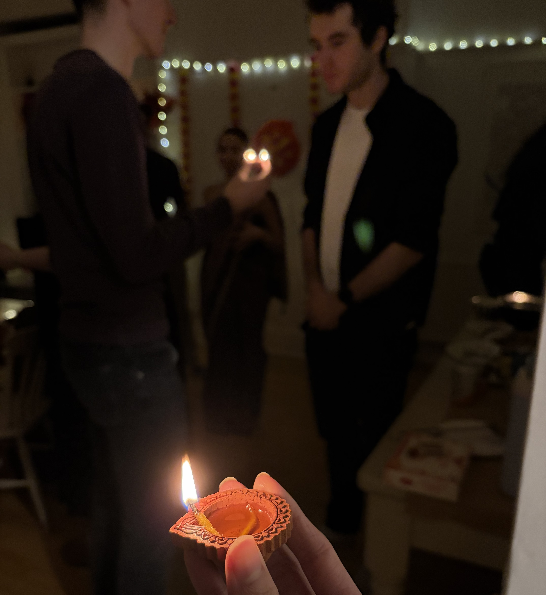

_Diwali at my friend's place_

On Sunday, inspired by my friend, I hosted a small candle-lit and diya-lit dinner for the household. I made tomato rice and chutney, both tasted delicious. There were no leftovers; that's how much Dan loved the food, especially the chutney.

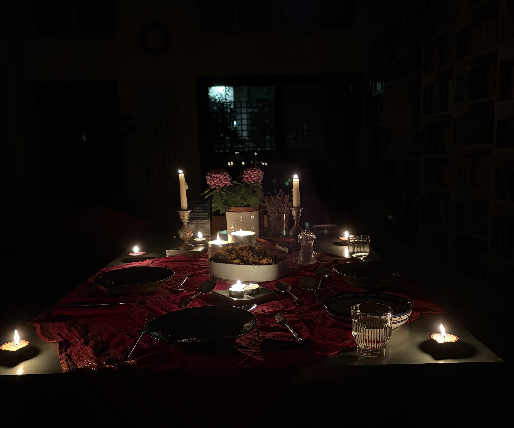

_Diwali at my own :)_

## 2026-11-09 to 2026-11-10 (Monday to Tuesday): Pre-birthday

It's funny how the days around your birthday are either seen as leading up to it or following on from it. Monday and Tuesday were definitely the pre-birthday filler days.

Monday, I took a day off to recover from festival activities. Tuesday, I spent the day working on the social media workshop which I'm jointly organising with Oxford Society for Science Communication and Engagement. Later in the day, I attended a Royal Society lecture on evolution with my new friend, Rohit. We spent some time walking around my favourite part of London: Southbank. It was meaningful going back to standing in front of London Eye and reflecting on how transformative 2026 was.

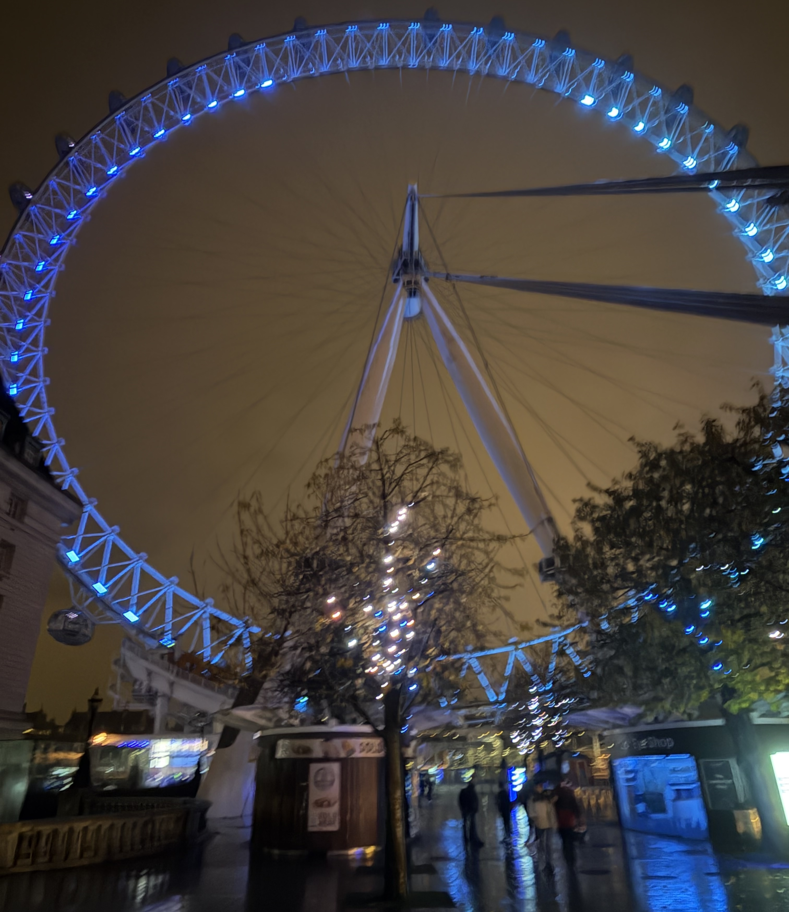

_In front of London Eye before I turned 25_

## 2026-11-11 (Wednesday): The day I turned 25
Although I made it a point to go to bed in time, I could not sleep at all at night. I read almost all birthday messages as soon as they were sent (classic!). As a result, I woke up tired and late for my birthday breakfast. I still find it funny that Dan and I were born on the same day. We had a joint breakfast together. I got two presents: Cat Stories from Everyman's Library Pocket Classics Series and a cat bookmark.

_GirlCat, Me, and Croissants_

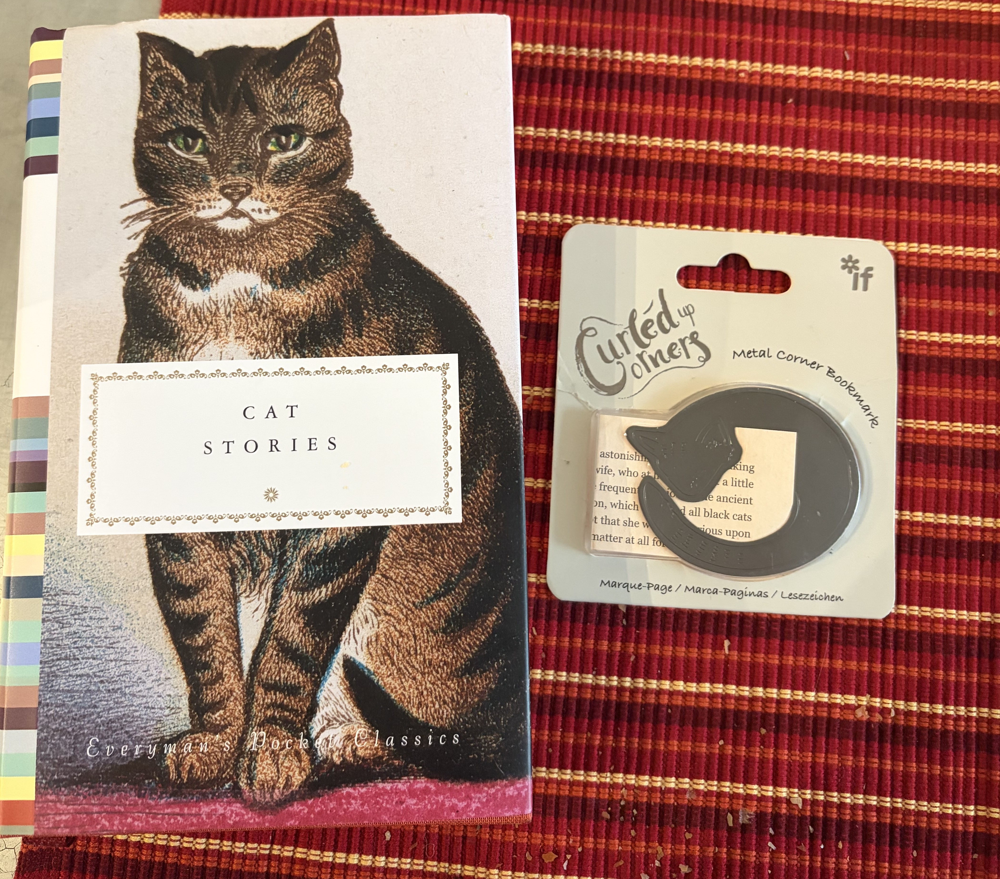

_My birthday presents_

Soon after, I left home to visit Dulwich Picture Gallery to see Hokusai's exhibition. The rainy wet day was made worse by P4 bus never arriving after having waited for half an hour. I had to take a different bus and as a consequence was late by 30 minutes. However, the staff did not make a fuss about it; so all good.

I had a fantastic time at the gallery. Hokusai's _36 view of mount fuji_ was fascinating; his detailed prints gave me a glimpse of life  and landscape around Mt. Fuji in the 18th century. His famous print, _The Great Wave_, resonated with me the most. The uncertainty of the boat surviving the great wave captures how I feel at the moment about my own life and where the world is headed (sorry, I know it's a broad brush stroke statement).

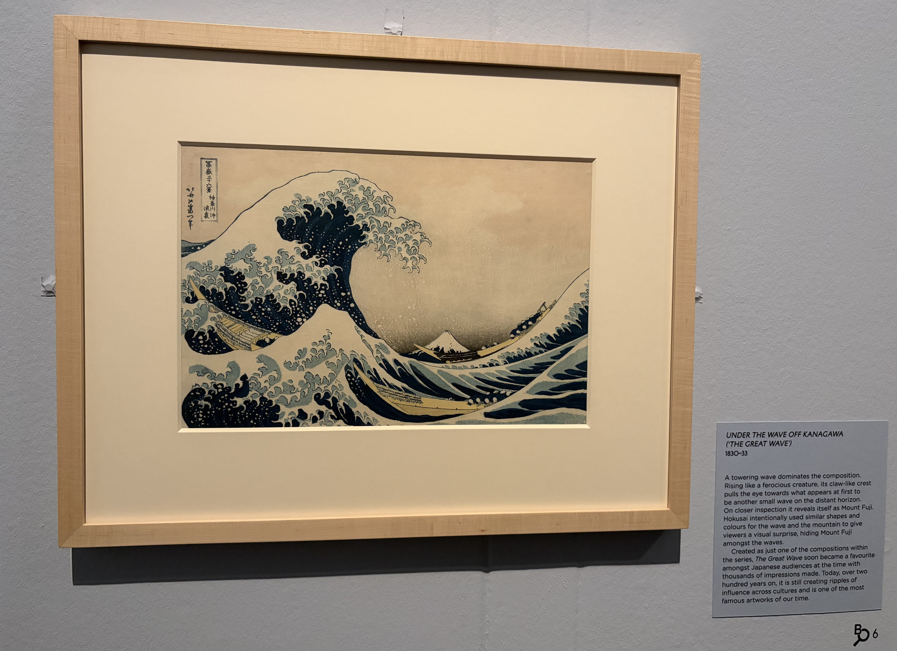

_The Great Wave_

I came home for lunch. I spent all my afternoon catching up with friends; some I hadn't spoken to for years now. I, then, reluctantly worked on the #semanticClimate poster before heading to my Merhaba, an Eritrean restaurant. Karin introduced me to Ethiopian/Eritrean food earlier this year and now my taste buds light up every time I think about Injera (which is like sour dosa) and all the curries, especially Shiro, the chickpea curry! There could not have been a better way to celebrate the day: dinner with my favourite people (Karin and Dan) at my favourite restaurant.

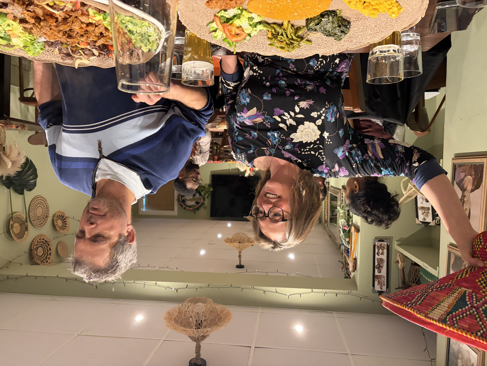

_Favourite people, Favourite food_

I like the restaurant more because there's more to it than the delicious food: an opportunity to form/solidify close bonds. Ethiopian food is served on a big shared plate. Everyone gets their Injera that they use to scoop up the curries they like from the shared plate. I only feel comfortable with sharing food only if I trust whom I'm with: Karin and Dan have obviously been those people. We've always had such fun banter when we've been to this restaurant (including on my birthday); something I'd like to cherish forever.

We quickly popped into M&S for dessert. We got a big chocolate tart; one could argue it was too chocolately, but not for me. I stayed back in the living room, reading the first story in the Cat Stories anthology. It was a particularly emotional short story in which the author reminisces about her beloved cat, who had passed away. As I was reading, GirlCat came over, and slept on me. Reading an emotional cat story with a cat on me was an ending the day needed.

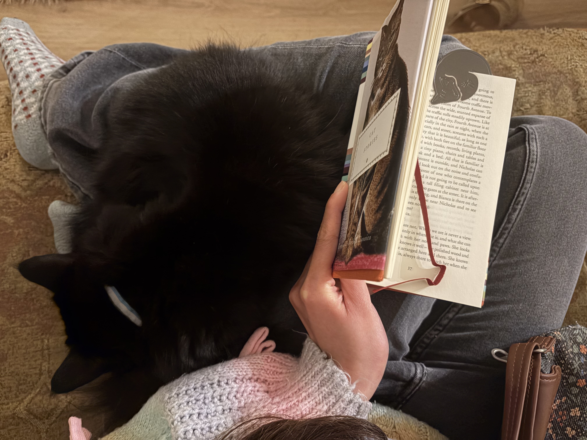

_Cat Stories, Cat, and me_

## 2026-11-12 to 2026-11-14: A conference and a workshop
I took the Thursday off to recover (as I should). I got the poster for the Knowledge Graph conference printed. I finalised the slides for the workshop.

Friday, I woke up at an ungodly hour at 0745 (much to GirlCat's disappointment) and left for City St George's (I didn't even know this University existed). 

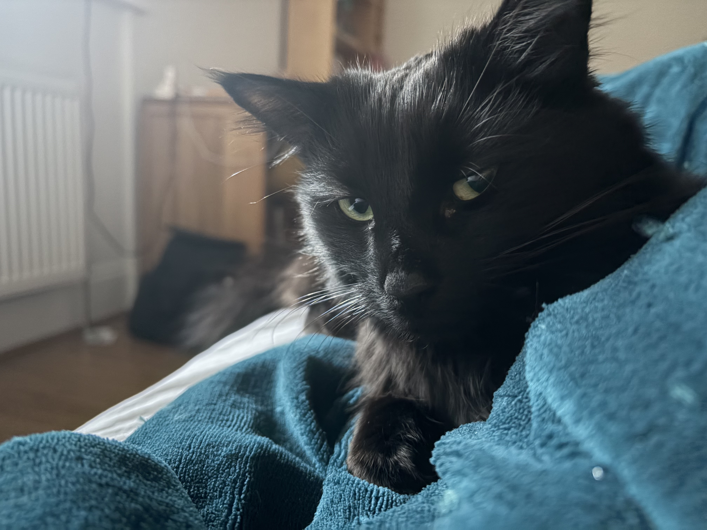

_GirlCat almost every morning these days_

I met Peter at the entrance of the university. I felt very out of place at this rather technical conference, where I wasn't even presenting my own work. On top of this, Peter forced me to give a presentation at a short notice. I spent the morning at the workshop creating a slide deck around the video presentations the team had produced. Given that I'm not a multi-tasker, I couldn't focus much on the presentation. But, some of the projects were interesting. The use of knowledge graphs by the Environment department to query water sampling data seemed like a good use-case.

My presentation went okay; got no feedback from the audience, wasn't surprised. It felt unfair that I was tasked to give this presentation, when I'm no longer involved with the team's work. I left the venue quickly, as soon as I was done. I came back home and worked on the slides for the workshop. I sent emails to participants and called it a day.

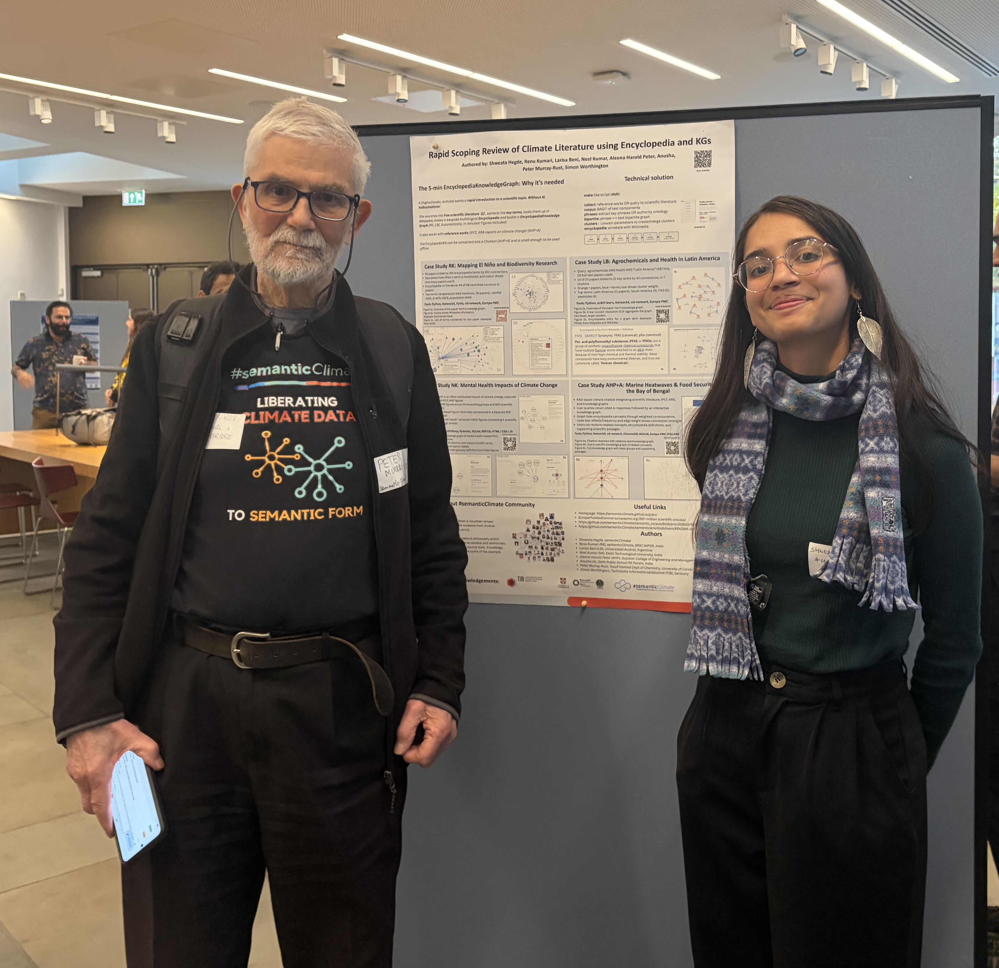

_Peter and me at the KG conference_

The journey to Oxford in the morning was pleasant. Given that I had spent the morning rehearsing my presentation, I felt confident. I wrote my script on the train, which was useful to organise thoughts. I had booked an earlier train ticket, just in case. I used the extra time to walk around. I walked past Radcliffe Cam, went to a public park, and saw a few colleges from the outside.

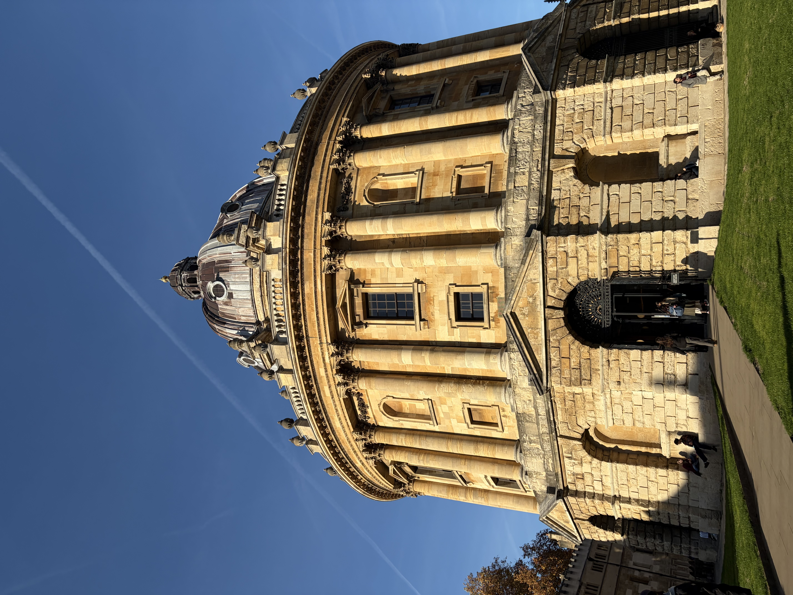

_Just Radcliffe Cam; it feels too cheesy to upload my selfie_

At 1400, I met one of the team members at Worcester college where we were running the workshop. After getting a brief college tour, we popped over the lecture room to set it up. Then, I waited outside the college to meet the participants who were doing the optional college tour. I, then, went back to the room and did some final setting up. Participants starting arriving after 1540. Slowly the room starting filling up.

Adrenaline took over nervousness; I think I did a good job with my slides. My slides covered:
- the need for scientists and science communicators to embrace social media. 
- a set of examples of science content on social media (different platforms, different intentions, different audience). I briefly touched up on commodification and commercialisation of knowledge (and everything honestly)
- the structure of the workshop series, with an emphasis on learning-by-doing (which is the whole reason why we collaborated with science-based charities)

I also had a few activities planned; they went alright.

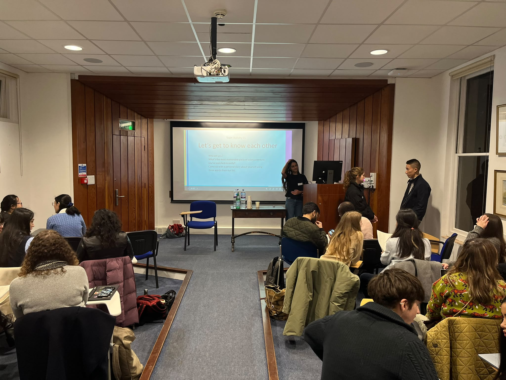

_Mixer_

The Oxford Society for Science Communication and Engagement's president discussed ABT statements and framework for strategic communication, both delivered very well!

I was pleased with myself and the team for pulling together this workshop where we brought together folks from Imperial, Oxford and UCL. Looking forward to seeing where we go from here!

I also had a good time at the pub after. I travelled back to London with two participants. I did some very small tasks before falling asleep. Slept well.

## 2026-11-15: Birthday Afternoon Tea
I woke up feeling exhausted (as usual); but it was one of those days where I felt satisfied being exhausted. I also finally got my periods. I'm so glad my body held up until the end of my birthday week. 

I was exhausted and in pain, but I had to show up to my own afternoon tea. Karin had spent many hours baking a cake for us. We'd also invited a few of our friends. A lovely mix of people! Conversations flowed. I got more presents, more flowers. The cake was delicious. We had some Breaky Bottoms wine to celebrate.

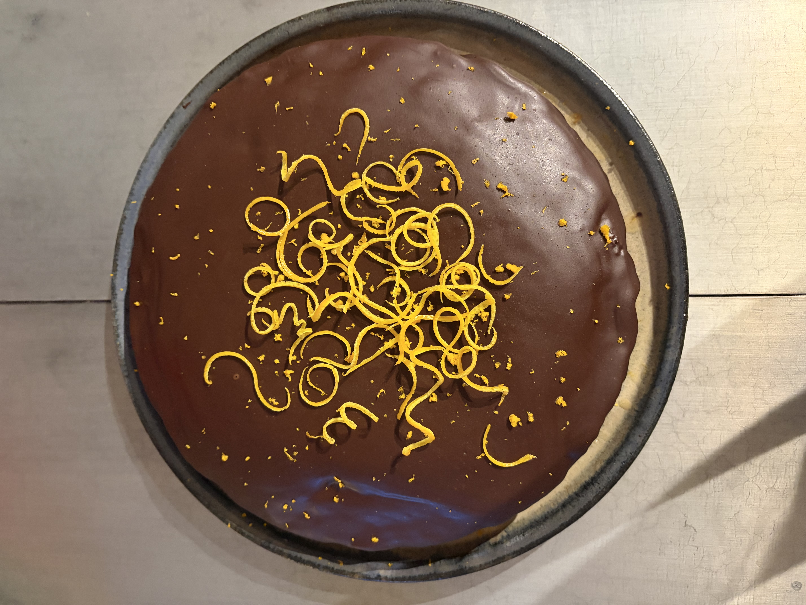

_Joint birthday cake_

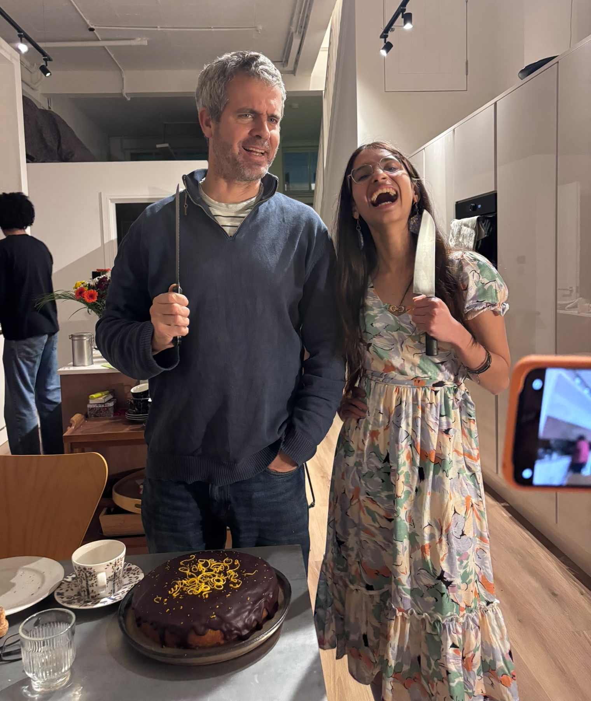

_Me and Dan before cutting our cake_

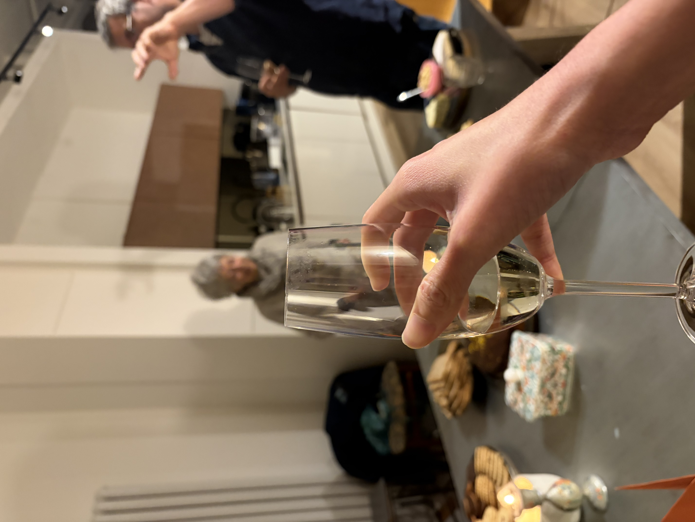

_Afternoon Tea party_

I fell asleep reading the newspaper.